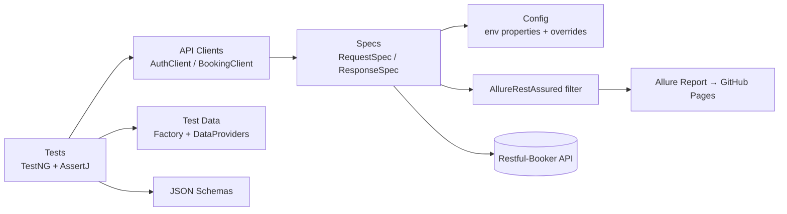

# Restful-Booker API Test Framework

[](https://github.com/deepakkumar216/restful-booker-api-tests/actions/workflows/api-tests.yml)
[](https://deepakkumar216.github.io/restful-booker-api-tests/)

API test automation framework for the public [Restful-Booker](https://restful-booker.herokuapp.com/apidoc/index.html) API, built with **Java 21, REST Assured, TestNG, Maven and Allure**. It runs on every push and every night in GitHub Actions, and publishes a live Allure report with trend history to GitHub Pages.

> 📊 **Live report:** https://deepakkumar216.github.io/restful-booker-api-tests/

## Highlights

| Area | What's implemented |
|---|---|
| **Layered design** | Tests → API clients → reusable request/response specs → config. Tests never build HTTP calls by hand. |
| **Typed models** | Java records for request/response POJOs, serialised with Jackson. One `Booking` type serves POST, PUT and PATCH (null fields are omitted). |
| **Contract checks** | JSON Schema validation for every response shape (`src/test/resources/schemas`). |
| **Data-driven** | TestNG `@DataProvider`s for valid edge cases, missing required fields, unknown IDs and bad credentials (including SQL-injection strings). |
| **Test data** | Randomised bookings from Datafaker, so parallel runs never collide. Every booking a test creates is deleted afterwards. |
| **Parallel runs** | Classes and data providers run in parallel. The auth token is fetched once and shared safely between threads. |
| **Environments** | `-Denv=qa` / `-Denv=local`. Any key can be overridden by a system property (`-DbaseUrl=…`) or an environment variable (`BASE_URL=…`). |
| **Reporting** | Allure, with each request and response attached to its step, severity, epic/feature/story labels and run-to-run history. |
| **Resilience** | A configurable retry for the flaky free host. Retries still show up in Allure, so flakiness stays visible. |
| **CI/CD** | GitHub Actions on push, PR, nightly cron and manual dispatch (choose the suite). Report published to `gh-pages`. |

## Architecture



```
src/test/java/com/sdet/booker
├── clients/     # AuthClient, BookingClient: one method per endpoint, annotated with @Step
├── config/      # Config: env properties, then env vars, then system properties
├── data/        # BookingFactory (Datafaker), BookingDataProviders
├── listeners/   # RetryAnalyzer + RetryTransformer
├── models/      # Booking, BookingDates, AuthRequest, CreateBookingResponse…
├── specs/       # Shared request/response specifications
└── tests/       # BaseTest (cleanup), HealthCheck, Auth, BookingCrud, BookingNegative
src/test/resources
├── config/      # qa.properties, local.properties
├── schemas/     # JSON Schemas
└── suites/      # regression.xml, smoke.xml
```

## Run it

You need JDK 17 or later. Maven is optional because the wrapper is included.

```bash
./mvnw test                          # full regression against the public API
./mvnw test -Dsuite=smoke            # smoke subset
./mvnw test -Denv=local              # against a local container (below)
./mvnw test -DbaseUrl=https://...    # point at any host
./mvnw allure:serve                  # open the Allure report locally
```

On Windows use `mvnw.cmd` instead of `./mvnw`.

Run the API locally with Docker:

```bash
docker run -d -p 3001:3001 mwinteringham/restfulbooker
./mvnw test -Denv=local
```

## Test coverage

| Suite | Tests |
|---|---|
| Health | `/ping` is up |
| Auth | Valid token issued; wrong password, wrong user, empty values and SQL injection are all rejected |
| Create / Read | Create then GET round-trip; 7 edge-case bookings (zero price, unicode names, same-day checkout…); list matches schema; filter by name |
| Update | PUT replaces the whole booking; PATCH changes only the fields sent |
| Delete | Booking removed, then GET returns 404 |
| Authorisation | PUT, PATCH and DELETE without a token or with a bad token return 403, and the booking survives |
| Validation | Each missing required field is rejected; unknown IDs return 404 |

## Defects and quirks found in the API

Testing exposed behaviour that a real team would raise as bugs. The tests pin the current behaviour, so any change is detected:

1. **Missing required fields return `500`, not `400`.** The server crashes instead of validating input.
2. **Bad credentials return `200`** with `{"reason":"Bad credentials"}` instead of `401`.
3. **Successful DELETE returns `201 Created`** instead of `200` or `204`.
4. **A multi-value `Accept` header returns `418 I'm a teapot`.** REST Assured's `ContentType.JSON` sends four MIME types, so the framework sends a plain `application/json`.

## Setting up the live report (one time)

1. Push to `main`. The first workflow run creates the `gh-pages` branch.
2. Go to **Settings → Pages**, choose **Deploy from a branch**, then `gh-pages` / `root`.

## Tech stack

Java 21 · REST Assured 5.5 · TestNG 7.10 · Jackson 2.17 · JSON Schema Validator · AssertJ · Datafaker · Allure 2.29 · Maven · GitHub Actions
